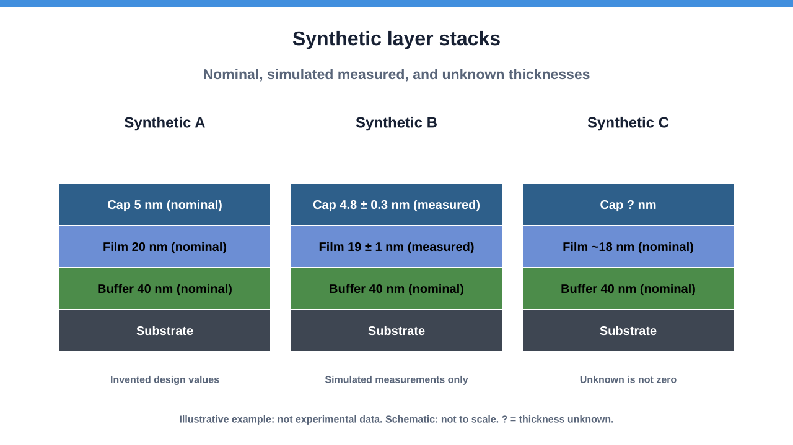

# Layer stacks with explicit thickness evidence

Status: `Runnable synthetic demonstration`

A layer-stack figure should distinguish a design value, a measurement, and an unknown thickness. This example turns a short structured description into an editable SVG while keeping those distinctions visible.



[Open the full-size figure](example/stack-01.svg) · [Inspect its fingerprint record](example/stack-01.svg.provenance.json) · [Source and input reference](https://github.com/JimmyRushing/mbe-research-public/tree/main/tools/stack_schematic)

## Read the example

All three stacks are invented. The materials are generic labels, the dimensions are arbitrary, and the values marked measured are simulated for this tutorial. They do not describe a real specimen or a growth recipe.

- **Synthetic A** shows nominal design thicknesses.
- **Synthetic B** shows simulated measurements with illustrative uncertainties, alongside a nominal buffer thickness.
- **Synthetic C** leaves the cap thickness unknown and marks one nominal value as approximate.

The substrate is a schematic strip. Equal-height boxes improve readability and do not represent equal physical thicknesses. A question mark means unknown; it does not mean a layer is absent.

## Generate the figure

Download or clone the [public repository](https://github.com/JimmyRushing/mbe-research-public), then run this command from its root using Python 3.11 or later. No packages need to be installed.

```sh
python -S tools/stack_schematic/build_stack_schematic.py --config tools/stack_schematic/examples/stacks.json --registry tools/stack_schematic/examples/registry.json --out-dir stack-output
```

Open `stack-output/stack-01.svg` in a browser or vector editor. The tool also writes `stack-01.svg.provenance.json`. Existing output folders are refused to protect earlier figures; use a fresh folder name for a second run.

## Follow one layer from input to figure

In [the example configuration](https://github.com/JimmyRushing/mbe-research-public/blob/main/tools/stack_schematic/examples/stacks.json), Synthetic B contains this film:

```json
{
  "material": "Film",
  "thickness": 19,
  "basis": "measured",
  "unit": "nm",
  "source_ref": "tutorial",
  "uncertainty": 1
}
```

The figure labels it `Film 19 ± 1 nm (measured)`. Here that is a simulated measurement. The `tutorial` reference explicitly identifies the source as invented tutorial values. The renderer checks that the reference exists; it cannot verify a measurement or interpret the uncertainty.

For an unknown thickness, use `"thickness": null` and `"basis": "unknown"`, and omit uncertainty and approximation. The label becomes `? nm`. The registry supplies each visible sample label; the layers are listed from the top surface down to the substrate.

## Try a controlled change

Copy the example JSON, change Synthetic A's nominal Film thickness from 20 to 25, and run the command with your copy and a new output folder. The label changes; the box height stays the same because the drawing is not to scale. The config and SVG fingerprints change, while unchanged input files keep their fingerprints.

Keep `"example": true` for invented values so the figure retains its visible warning. Before sharing your own figure, inspect every label and its source data. Public-looking labels alone do not make research material suitable for release.

## Reproducibility and limits

The companion record contains SHA-256 hashes and byte counts for the output and five input roles. It includes no local paths or copied input metadata. The same input files and renderer produce byte-identical SVG and companion records. These fingerprints establish file identity, not scientific validity.

The generator supports up to eight layers per stack and three stacks per page, with additional pages for longer comparisons. Text fitting is approximate, and fonts can change the appearance across computers. Review the output visually. See the [input contract and tests](https://github.com/JimmyRushing/mbe-research-public/tree/main/tools/stack_schematic) for validation rules.

This complements the existing [growth-database demo](../growth-database/index.md): the stack generator uses explicitly described layers, while the older database script draws simplified stacks from detected growth segments.
